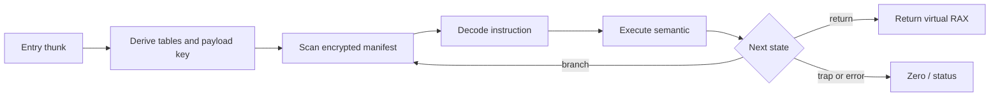

# Sirus

**Selective x86-64 code virtualization with a zero-dependency, safe-Rust runtime.**

[](https://github.com/FutureProofsTech/Sirus/actions/workflows/windows-wine.yml)
[](LICENSE)

Sirus is a binary-level code virtualizer for selected x86-64 functions. It lifts a
function from an ELF or PE32+ image into a typed intermediate representation,
flattens and rewrites its control flow, expands sensitive arithmetic through
mixed Boolean-arithmetic (MBA) identities, encodes the result into a per-build
randomized encrypted instruction set, generates a freestanding `no_std` Rust
virtual machine, injects that VM into a new executable segment, patches the
original entry point to jump into it, and destroys the original function body.

The default artifact contains no `unsafe` Rust in the generated runtime and no
third-party crates in shipped code. An optional hardened tier adds
platform-specific anti-debug, timing, and self-integrity controls behind an
explicit unsafe boundary.

Sirus is an engineering prototype for **asymmetric reverse-engineering cost**,
not a claim of mathematical unbreakability. The architecture, measured evidence,
and residual risks are documented in full:

- [Technical white paper (PDF)](docs/whitepaper/sirus-whitepaper.pdf)
- [Architecture](docs/ARCHITECTURE.md)
- [Verification record](docs/VERIFICATION.md)
- [Threat model](docs/THREAT_MODEL.md)
- [Limitations and non-capabilities](docs/LIMITATIONS.md)
- [Measured positioning](docs/POSITIONING.md)

---

## At a glance

| Property | Status |
|---|---|
| Input formats | ELF64 x86-64; PE32+ AMD64 |
| Protection scope | Selected leaf functions and direct calls between selected functions |
| Runtime | Generated `no_std` Rust; no libc, no heap, no `unsafe` in the safe tier |
| Virtual ISA | 48 semantic operations; 4 aliases each; randomized operand order, register maps, and endianness |
| Payload | Encrypted shuffled manifest and rolling-key body stream; SipHash-2-4 integrity binding |
| Control flow | Flattening with random 64-bit state ids; opaque guards and decoy blocks |
| Arithmetic | Bounded linear and non-linear MBA; constant blinding |
| Constant time | Optional fixed-pass oblivious branch, loop, and private-memory execution |
| Hardening | Optional `--hardened` tier: tracer detection, RDTSC/LFENCE, debug-register reporting, self-code checksum |
| Verification | 226 tests; Kani, Miri, libFuzzer, differential/tamper/bypass, Ghidra, radare2, angr, KLEE, Creusot, dudect, cachegrind |
| Coverage | 87.07% tarpaulin / 88.25% llvm-cov lines |
| License | GPL-3.0-only |

---

## Design goals

Sirus is built around six constraints:

1. **Fail closed.** Unsupported instructions and malformed bytecode are rejected;
   the runtime never guesses or silently skips an operation.
2. **Zero shipped dependencies.** The compiler core and VM use only `core`; the
   protector CLI uses `std` only at the filesystem and process boundary.
3. **Memory safety by construction.** The safe tier forbids `unsafe`, heap
   allocation, panics in normal execution, and host-memory access. Every array
   access is checked.
4. **Per-build diversity.** A 256-bit seed controls opcode aliases, operand
   order, register encoding, immediate endianness, state ids, block order,
   encryption keys, MBA shapes, decoys, and code/data placement.
5. **Honest evidence.** Performance, coverage, external-tool results, and
   residual weaknesses are recorded with their exact scope. No result is
   presented as a whole-product proof when it is a bounded model or a timeout.
6. **Separated trust boundaries.** Debugger and timing controls require unsafe
   OS interfaces, so they live in an opt-in `sirus-hardened` crate rather than
   contaminating the safe default runtime.

---

## Architecture

```mermaid
flowchart LR
    A[Input ELF / PE32+] --> B[Parse, validate, select]
    B --> C[Decode and lift]
    C --> D[Typed IR and CFG]
    D --> E[Flatten, MBA, decoys]
    E --> F[Randomized ISA encoding]
    F --> G[Encrypt manifest and bodies]
    G --> H[Generate no_std Rust VM]
    H --> I[Compile and validate blob]
    I --> J[Inject RX segment]
    J --> K[Patch entry and scrub body]
    K --> L[Protected binary]
```



The build pipeline is deterministic for a fixed input, seed, profile, and
toolchain. Omit `--seed` to derive the plan from OS entropy.

At runtime, a normal host call reaches an ABI shim, which preserves the host
calling convention, copies register and stack arguments into the VM's private
state, and enters the dispatcher:



The VM executes only on a private 4 KiB byte-addressable stack and a private
read-only data blob. It cannot read or write host memory.

---

## Quick start

### Build

```sh
cargo build --release -p sirus-protector
```

The repository pins stable Rust 1.99.0 and the Windows GNU target in
`rust-toolchain.toml`. Linux VM linking uses `cc` with LLD and `objcopy`;
Windows cross-linking uses `x86_64-w64-mingw32-gcc` and `lld-link`.

### Protect a C function

```c
__attribute__((noinline, used))
unsigned long license_mix(unsigned long a, unsigned long b) {
    unsigned long x = a ^ (b + 0x9e3779b97f4a7c15UL);
    x = (x << 7 | x >> 57) + (a & 0xffff);
    return x ^ (b * 0xbf58476d1ce4e5b9UL);
}
```

```sh
cc -O2 -fno-builtin -fPIE -pie -o victim victim.c

./target/release/sirus protect \
    --input victim \
    --output victim.protected \
    --function license_mix \
    --seed 00112233445566778899aabbccddeeff00112233445566778899aabbccddeeff

./victim.protected 7 3
```

### Protect a Rust function

```sh
rustc --edition=2021 -C opt-level=2 -C panic=abort -C debuginfo=0 \
    victim.rs -o victim

./target/release/sirus protect \
    --input victim \
    --output victim.protected \
    --function-contains sirus_demo_check \
    --seed 00112233445566778899aabbccddeeff00112233445566778899aabbccddeeff
```

Use `--function` for an exact symbol, `--function-contains` for a unique
substring, `--range` for an explicit executable range, or
`--marker-begin`/`--marker-end` for raw byte markers. A fully stripped binary
requires marker or range selection.

### Inspect

```sh
./target/release/sirus inspect victim.protected
./target/release/sirus version
```

---

## Command-line interface

```text
sirus protect --input <ELF-or-PE> --output <path> <selector> [options]
sirus inspect <ELF-or-PE>
sirus version
```

| Option | Meaning |
|---|---|
| `--function <symbol>` | Protect one exact symbol |
| `--function-contains <text>` | Protect a unique symbol substring |
| `--range <rva:size>` | Protect an explicit executable range |
| `--marker-begin <hex>` / `--marker-end <hex>` | Raw byte-delimited range |
| `--seed <64-hex>` | Deterministic 256-bit build seed |
| `--profile <max\|balanced\|minimal\|fast>` | Security/performance preset |
| `--follow-calls` | Lift resolvable direct local callees |
| `--fuel <n>` | Runtime instruction budget (default 2,000,000) |
| `--mba-depth <0..8>` / `--mba-budget <n>` | MBA rewrite budget |
| `--decoys <n>` | Opaque guard/decoy pairs per function |
| `--constant-time` | Enable fixed-pass oblivious execution |
| `--constant-time-passes <1..4096>` | Loop frontier budget (default 256) |
| `--vm-base <hex>` | Override the injected VM virtual address |
| `--emit-source <path>` | Write the generated VM source for audit |
| `--keep-temp` | Retain compiler temporary files |
| `--no-scrub` | Do not destroy the original function body |
| `--hardened` | Enable the optional unsafe hardening tier |

---

## Supported code and ABI

Sirus supports a deliberately strict subset of x86-64. Anything outside the
subset fails the build with an offset and reason; it is never skipped.

**Integer and control flow:** `mov`, `movzx`, `movsx`, `movsxd`, `lea`, `add`,
`sub`, `and`, `or`, `xor`, `cmp`, `test`, `inc`, `dec`, `neg`, `not`, `imul`,
shifts, rotates, `bswap`, `push`, `pop`, `leave`, `cdqe`, `jmp`, `jcc`, `ret`,
`cmovcc`, `setcc`, and 8/16/32/64-bit private-memory widths.

**Additional forms:** RIP-relative reads of read-only data, System V stack
arguments 7–12, Win64 stack arguments 5–10, direct `call rel32` between selected
functions, `--follow-calls` for resolvable local callees, SSE2 integer moves and
arithmetic, VEX-encoded 128-bit AVX integer forms, and `rep movsb`/`movsq`/
`stosb`/`stosq` over private memory.

**Fail-closed examples:** external or indirect calls, writable RIP-relative
globals, absolute host addresses, jump tables, 256-bit AVX/AVX2, x87, MMX,
floating point, syscalls, atomics, segment/address-size overrides, lock
prefixes, unsupported flag liveness, functions larger than 16 KiB, and programs
that exceed fixed capacities.

The Linux backend implements the System V AMD64 integer ABI: six register
arguments, stack arguments 7–12, and one integer result. The Win64 backend
implements four register arguments, stack arguments 5–10, one integer result,
and preserves the Windows callee-saved XMM range through the shim. Floating-point
arguments and results are not supported.

See [`docs/LIMITATIONS.md`](docs/LIMITATIONS.md) for the complete boundary.

---

## Security model

Sirus raises the cost of static and dynamic recovery. It does **not** make a
program impossible to reverse engineer, and it does not protect secrets against
an attacker who controls the machine and can instrument arbitrary execution.

The intended adversary can read the binary, run decompilers and MBA simplifiers,
trace with DBI tools, dump process memory, patch files or memory, compare builds,
fuzz the VM, and use a hypervisor debugger. Sirus addresses that adversary with:

- removal and scrubbing of the original function body;
- encrypted, shuffled bytecode with no decrypted body cache;
- per-build randomized opcode aliases, operand order, register maps, and
  endianness;
- flattened control flow with random state ids and decoy paths;
- bounded MBA rewriting and constant blinding;
- payload integrity binding through a keyed hash;
- masked virtual registers and private memory at rest;
- deterministic fuel bounds and fail-closed malformed-input handling.

The default branchy profile is **not** constant-time. `--constant-time` adds a
fixed-pass oblivious execution mode for branches, loops, and private memory, with
a documented pass bound. The safe tier does not implement kernel-level
anti-debug, trusted signing, or a formal Spectre proof.

Operational guidance: use Sirus for license checks, protocol constants, key
derivation, or proprietary integer logic where per-build mutation and data
binding matter. Do not use it as the only control for high-value secrets on an
untrusted host.

See [`docs/THREAT_MODEL.md`](docs/THREAT_MODEL.md) and the white paper for the
full objective-by-objective analysis.

---

## Constant-time execution

`--constant-time` selects a second execution path in the VM. On every pass it
decodes and executes **every** manifest block, carries the active path in a
frontier mask, and applies register writes through a bitwise select:

```text
new_value = (proposed & active) | (old_value & ~active)
```

Conditional branches enqueue both successors with complementary masks. Private
loads and stores scan the whole private stack with masked selection, so the
instruction stream and memory-address pattern do not depend on the branch
decision or secret address.

Programs without cycles use an exact block-count bound. Any program containing a
loop uses `--constant-time-passes` (default 256, maximum 4096); a frontier that
does not converge returns `LoopBound`. The mode is deliberately slower and is
not a general unbounded constant-time guarantee.

Measured with dudect-bencher on the release tree: the cipher path is below the
conventional `|t| = 5` threshold (`|t| = 2.39`), the four constant-time VM cases
are below it (worst `|t| = 3.19`), and the normal branchy VM profile leaks
(`|t| = 204`). Cachegrind reports identical instruction, data, branch, and
cache-miss counts for the branch-only constant-time leaf across two inputs.

---

## Hardened tier

The safe tier remains `forbid(unsafe_code)`. `--hardened` generates entries that
call the optional `sirus-hardened` runtime:

- Linux raw-syscall `/proc/self/status` tracer detection;
- Windows PEB `BeingDebugged` and `NtGlobalFlag` checks;
- LFENCE-serialized RDTSC timing budgets;
- Windows debug-register reporting through `harden-check`;
- linked text checksums on Linux and Windows with tamper rejection;
- fail-closed return value `0` on a failed check.

```sh
./target/release/sirus harden-check
./scripts/hardened-check.sh
```

Kernel-level anti-debug, DBI detection, signing, and runtime exception
propagation remain out of scope and are documented as such.

---

## Verification

The fast release gate is:

```sh
./scripts/verify.sh
```

It runs formatting, Clippy with `-D warnings` across all targets, all tests,
rustdoc with warnings denied, `cargo deny`, `cargo audit`, Kani proofs, the
red-team harness, the Linux ABI regression, the constant-time cachegrind check,
and release-artifact generation.

The long proof gate is:

```sh
./scripts/prove.sh
```

It runs Kani, Miri on the core and VM unit tests, and libFuzzer. Set
`SIRUS_FULL_MIRI=1` for the full execution suite, `SIRUS_COVERAGE=1` for
coverage, and the individual `SIRUS_*` flags for external evidence tools.

| Gate | Latest recorded result |
|---|---|
| `cargo test --workspace` | **226 passed, 0 failed, 2 ignored** |
| `cargo test --workspace --release` | **226 passed** |
| Kani | **5 core + 4 VM harnesses verified** |
| Miri VM library | **11/11** |
| libFuzzer, 61 s each | **789,455 VM**, **133,973 lifter**, **13,516,906 ELF**, **26,539,167 PE** runs, no crash |
| Coverage | **87.07% tarpaulin** (7607/8737) / **88.25% llvm-cov lines** |
| Ghidra 12.2 | 19 scoped functions; 18/19 decompiled; host targets end in `halt_baddata()` |
| radare2 5.9.8 | patched functions reduce to jump/goto stubs |
| angr 10.0.7 | 120 s bounded symbolic timeout, no preimage |
| KLEE 3.3 | 7,234,878 instructions, 8 partial paths, no memory errors |
| Creusot 0.15 | 3 boundary models proved |
| dudect-bencher | cipher 2.39, constant-time worst 3.19, normal VM 204 |
| Windows | Wine, native Windows, and MSVC `/guard:cf` jobs green |

External evidence and exact commands are recorded in
[`docs/VERIFICATION.md`](docs/VERIFICATION.md). The red-team analysis is in
[`docs/RED_TEAM.md`](docs/RED_TEAM.md).

---

## Performance

Measured on an Intel Core i5-14400F, 16 threads, Linux x86-64, using the same
leaf function and 1,000 calls per sample (median of seven samples):

| Build | Per call | Relative to native | Relative to VMProtect 3.11 demo |
|---|---:|---:|---:|
| Native | ~1.2–1.4 ns | 1× | ~0.0002× |
| VMProtect 3.11 demo, virtualization | 8.48 µs | ~4,490× | 1× |
| Sirus fast/minimal | 14.5 µs | ~6,100× | ~1.7× |
| Sirus balanced | 53.9 µs | ~30,000× | ~6.7× |
| Sirus default | 75.0 µs | ~49,800× | ~9.3× |
| Sirus hardened | 78.5 µs | ~40,600× | ~9.0× |
| Sirus constant-time | 234 µs | ~101,500× | ~25.2× |
| Sirus hardened constant-time | 235 µs | ~111,300× | ~25.5× |

Sirus does not pack the host image: cold startup is about 0.6 ms and the default
VM adds about 30 KiB (0.7%) to the benchmark binary. The VMProtect demo packs the
whole image and starts in about 2.6 s on the same host. The comparison is a
measured engineering datapoint, not a claim of equivalent security profiles.

Method and caveats: [`docs/POSITIONING.md`](docs/POSITIONING.md).

---

## Platform support

| Platform | Status |
|---|---|
| Linux x86-64 ELF | Primary production path; full pipeline and release gate |
| Windows PE32+ | Selective leaf subset; Wine, native Windows, and MSVC `/guard:cf` CI |
| Other ELF architectures | Not supported |
| Mach-O / ARM64 / 32-bit x86 | Not supported |

The Windows backend protects selected AMD64 functions, appends one executable
`.sirus` section, merges linked `.pdata` unwind records for the shim, and
preserves DLL exports, TLS callbacks, and `RCDATA` resources in the tested
fixtures. External imports, language exception propagation, and kernel anti-debug
remain out of scope.

---

## Repository layout

```text
crates/sirus-core       no_std compiler, decoder, IR, lifter, MBA, ISA, cipher, encoder
crates/sirus-vm         no_std VM engine and execution tests
crates/sirus-binfmt     no_std ELF/PE parsers and safe editors
crates/sirus-protector  std CLI, source generation, rustc driver, injection pipeline
bench/                  reproducible call-overhead victim and comparison
fuzz/                   cargo-fuzz harnesses (external verification tooling)
verification/creusot    Creusot/Why3 boundary models
verification/dudect     official dudect-bencher harness
scripts/                verify, prove, red-team, external checks, tool installer
docs/                   architecture, formats, threat model, evidence, white paper
```

---

## Documentation

| Document | Contents |
|---|---|
| [White paper](docs/whitepaper/sirus-whitepaper.pdf) | Full technical and empirical treatment |
| [Architecture](docs/ARCHITECTURE.md) | Build pipeline, runtime, injection geometry |
| [Wire format](docs/FORMAT.md) | Virtual ISA, manifest, body cipher, entry thunks |
| [Threat model](docs/THREAT_MODEL.md) | Assets, adversary, objectives, failures |
| [Limitations](docs/LIMITATIONS.md) | Supported subset, ABI, residuals |
| [Verification](docs/VERIFICATION.md) | Exact commands and recorded results |
| [Red team](docs/RED_TEAM.md) | Adversarial analysis and residuals |
| [Decisions](docs/DECISIONS.md) | Architecture decision records |
| [Windows](docs/WINDOWS.md) | PE32+ backend and Win64 runtime |
| [Positioning](docs/POSITIONING.md) | Measured comparison with commercial/research tools |
| [Release notes](RELEASE.md) | Release scope and evidence |
| [Security policy](SECURITY.md) | Vulnerability reporting |

---

## Build and test

```sh
# Fast local release gate
./scripts/verify.sh

# Long proof/fuzz gate
./scripts/prove.sh

# External evidence (opt-in)
SIRUS_GHIDRA=1 SIRUS_RADARE2=1 SIRUS_MBA=1 SIRUS_ANGR=1 \
SIRUS_KLEE=1 SIRUS_CREUSOT=1 SIRUS_DUDECT=1 \
SIRUS_CONSTANT_TIME=1 SIRUS_WINDOWS=1 ./scripts/prove.sh

# Reproducible output check
./scripts/reproducible-check.sh

# Windows/Wine matrix
./scripts/windows-wine-check.sh
```

Requirements: Rust stable 1.99.0 (pinned), a C compiler, LLD, `objcopy`, and
`rustc` at protection time. External evidence tools are installed by
`scripts/install-tools.sh` and are not runtime dependencies.

---

## Known limitations

Sirus is a selective protector, not a whole-program virtualizer. It does not
support external calls, host pointers, writable RIP-relative globals, indirect
jumps, jump tables, floating point, x87, AVX-256, other instruction-set
extensions, or programs that exceed the bounded IR and payload capacities. It
does not implement kernel anti-debug, trusted signing, or a formal Spectre
proof. The normal profile leaks timing by design; use `--constant-time` only for
the documented fixed-pass subset.

The full list, including the exact ABI and platform boundaries, is maintained in
[`docs/LIMITATIONS.md`](docs/LIMITATIONS.md).

---

## Security reporting

Report suspected vulnerabilities with the exact commit, a minimal reproducer,
the protection command and seed if applicable, observed versus expected
behavior, and whether the issue is a memory-safety flaw, a protection bypass, an
integrity failure, or a timing leak. See [`SECURITY.md`](SECURITY.md).

Do not deploy Sirus as the sole control for high-value secrets without an
independent audit.

---

## License

Sirus is licensed under the **GNU General Public License, version 3 only**
(`GPL-3.0-only`). See [`LICENSE`](LICENSE).

---

## Citation

If you use Sirus in academic work, cite the white paper:

```bibtex
@techreport{sirus2026,
  title       = {Sirus: A Zero-Dependency, Safe-Rust Code Virtualizer for
                 Selective x86-64 Protection},
  author      = {{The Sirus Project}},
  institution = {Sirus Project},
  year        = {2026},
  note        = {Version 1.5.9-hardened},
  url         = {https://github.com/FutureProofsTech/Sirus}
}
```
